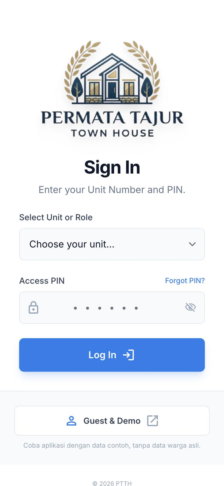
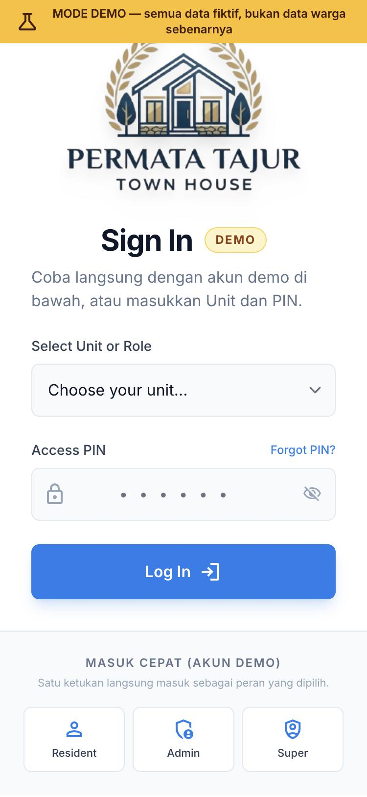
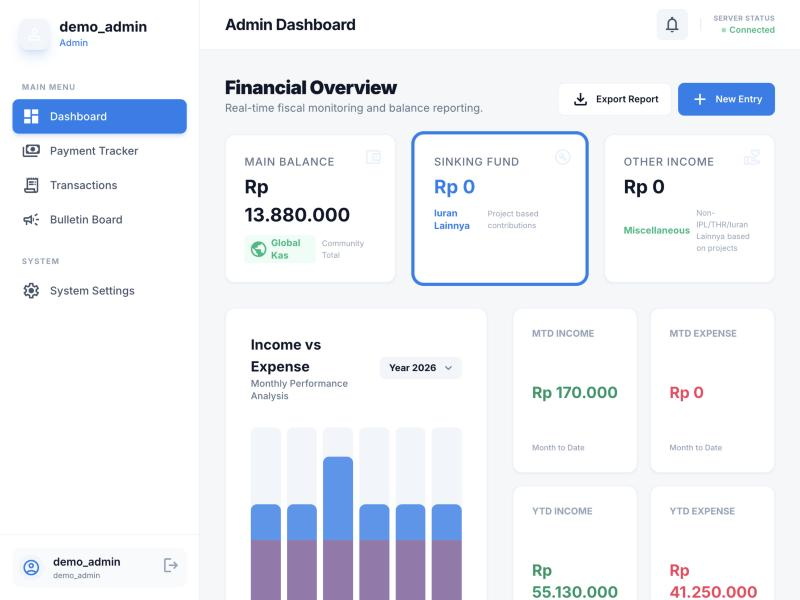
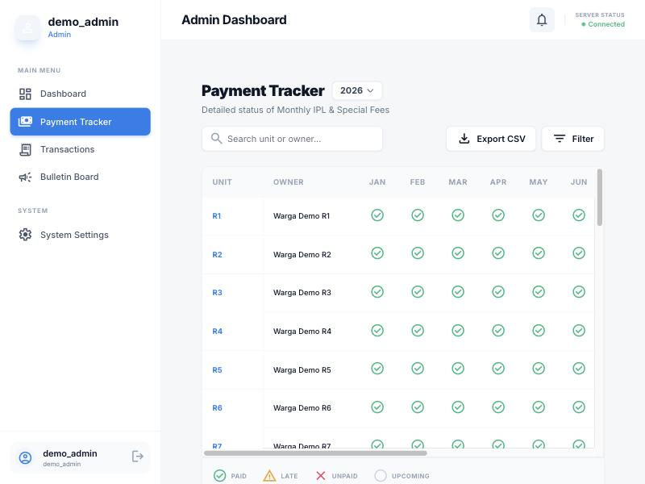
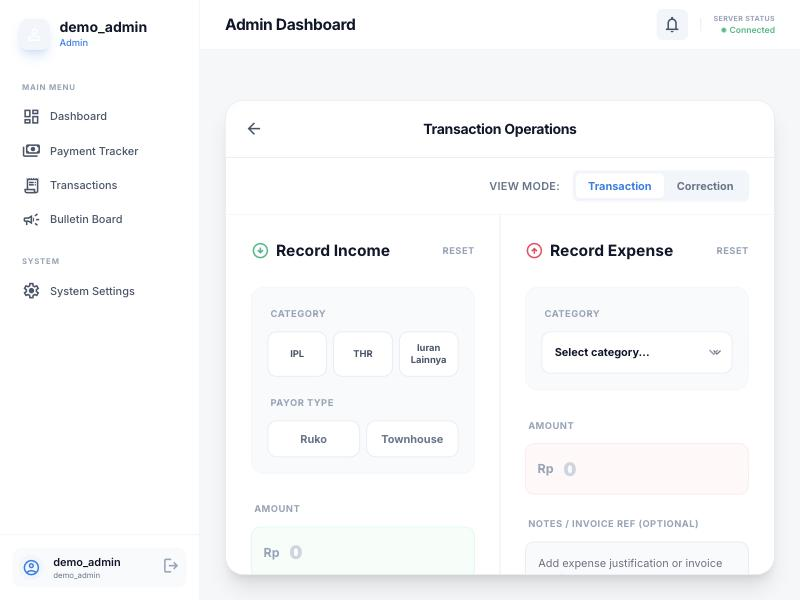
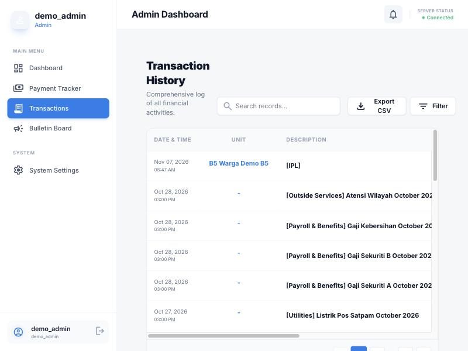
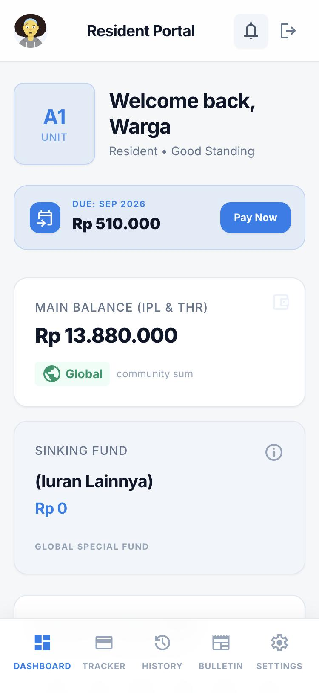
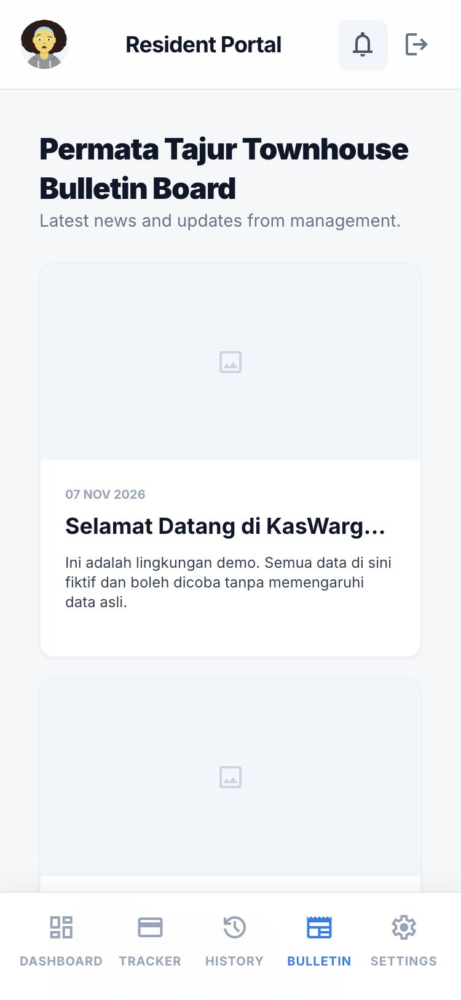

# KasWarga

Aplikasi pencatatan kas warga untuk satu kompleks perumahan — iuran bulanan (IPL), iuran tahunan (THR), pengeluaran kompleks, dan papan pengumuman dalam satu tempat.


---

## Coba demonya

**<https://kaswarga-demo.netlify.app>**

Situs demo berjalan di database terpisah dengan data dummy. Pada aplikasi yang sebenarnya, halaman login (kiri) menampilkan satu tombol **Guest & Demo** yang membuka situs demo ini di tab baru. Di situs demo (kanan), tombol **Masuk Cepat** langsung memasukkan Anda tanpa kredensial.

<p align="center">
  
  &nbsp;&nbsp;
  
</p>

---

## Fitur

### Untuk warga

- **Dashboard pribadi** — saldo kas kompleks, tagihan yang jatuh tempo berikutnya, dan ringkasan pembayaran unit sendiri.
- **Tracker pembayaran tahunan** — status IPL tiap bulan dan THR tahunan, ditandai lunas, terlambat, atau belum jatuh tempo.
- **Riwayat transaksi** — pembayaran unit sendiri digabung dengan pengeluaran kompleks, dengan pencarian, filter, dan ekspor CSV.
- **Panduan pembayaran** — QRIS sesuai nominal tagihan, atau pilih sendiri tagihan mana yang akan dibayar.
- **Papan pengumuman** — pengumuman pengurus beserta lampiran gambar, video, atau PDF.
- **Pembaruan realtime** — pengumuman baru dan pembayaran yang tercatat muncul tanpa memuat ulang halaman.
- **Pengaturan akun** — ganti PIN sendiri dan unggah foto profil.

### Untuk pengurus

- **Dashboard keuangan** — saldo kas, ringkasan pemasukan dan pengeluaran bulan berjalan dan tahun berjalan, grafik bulanan, serta transaksi terbaru.
- **Tracker seluruh unit** — matriks semua unit terhadap 12 bulan dan THR, dengan pencarian, filter, rekap tunggakan, dan ekspor CSV.
- **Input transaksi** — pencatatan pemasukan (IPL, THR, iuran lainnya) dan pengeluaran berkategori dalam satu halaman.
- **Koreksi keuangan** — penyesuaian saldo untuk kesalahan pencatatan, tertandai terpisah agar jejaknya jelas.
- **Pengelolaan unit** — daftar unit beserta datanya.
- **Penjadwalan iuran tahunan** — menggeser bulan jatuh tempo THR untuk tagihan yang belum dibayar.
- **Papan pengumuman** — editor rich text dengan gambar dan lampiran, simpan sebagai draf atau terbitkan.
- **Log aktivitas** — rekam jejak tindakan penting di aplikasi.

### Lintas peran

- **Mobile-first** — dirancang untuk layar ponsel lebih dulu: navigasi bawah untuk warga, sidebar untuk pengurus, lalu melebar di tablet dan desktop.
- **Realtime** — perubahan data langsung memicu penyegaran halaman yang sedang dibuka, dengan penggabungan event dan pengambilan ulang otomatis saat tab kembali aktif atau koneksi pulih.
- **Indikator koneksi** — status sambungan ke database dipantau berkala dan ditampilkan ke pengguna.

---

## Tampilan

> Semua tangkapan layar diambil dari situs demo, bukan dari aplikasi produksi, agar tidak ada data warga asli yang terpampang.

### Pengurus


*Ringkasan saldo kas, pemasukan dan pengeluaran, serta grafik bulanan.*


*Matriks IPL 12 bulan untuk seluruh unit, lengkap dengan pencarian, filter, dan ekspor CSV.*


*Pencatatan pemasukan dan pengeluaran bersebelahan dalam satu halaman.*


*Riwayat seluruh aktivitas keuangan dengan pencarian, filter, dan paginasi.*

### Warga

<p align="center">
  
  &nbsp;&nbsp;
  
</p>

*Dashboard warga dan papan pengumuman pada layar ponsel.*

---

## Teknologi

| Lapisan | Teknologi | Versi |
| --- | --- | --- |
| Framework | Nuxt, mode SPA (`ssr: false`) | ^4.6.4 |
| UI | Vue 3 | 3.5.x |
| Styling | Tailwind CSS + plugin forms, typography, container-queries | ^3.4.19 |
| State | Pinia + pinia-plugin-persistedstate | ^3.0.4 |
| Backend | Supabase JS — Postgres, Storage, Realtime | ^2.49.4 |
| Editor teks | Tiptap | ^3.22 |
| Sanitasi HTML | DOMPurify | ^3.3.3 |
| QR pembayaran | qrcode.vue | ^3.8.1 |
| Pemantauan error | Sentry untuk Vue | ^10.48.0 |
| Runtime | Node.js | ^20.19.0 \|\| >=22.12.0 |
| Hosting | Netlify, situs statis | — |

---

## Arsitektur

```
src/
├─ app.vue                 # root: error boundary + NuxtPage + overlay pemeliharaan
├─ router.options.js       # definisi rute manual (bukan file-based), hash mode
├─ middleware/             # guard navigasi global berbasis meta rute
├─ plugins/                # pinia-persistedstate, monitoring (client-only)
├─ views/                  # satu file per rute
├─ components/
│  ├─ layout/              # LayoutWrapper memilih AdminLayout atau ResidentLayout
│  ├─ dashboard/           # AdminDashboard, ResidentDashboard
│  ├─ modals/              # modal pembayaran, detail pengumuman
│  ├─ forms/               # editor rich text (dimuat lazy)
│  └─ common/              # error boundary, overlay pemeliharaan
├─ composables/            # useAuth, useRealtimeRefresh
├─ stores/                 # Pinia: auth, status sistem
├─ services/               # satu modul per domain, semua akses Supabase lewat sini
├─ utils/                  # format angka dan tanggal, sanitasi HTML, QRIS
└─ assets/styles/          # Tailwind dan gaya global
```

Aplikasi berjalan sebagai SPA murni (`ssr: false`): Netlify menyajikan berkas statis, dan seluruh render terjadi di browser. Rute memakai hash routing (`/#/app/...`) sehingga tautan lama tetap berlaku tanpa bergantung pada aturan rewrite server. Rute didefinisikan manual di `src/router.options.js`, sebuah middleware global memeriksa meta tiap rute sebelum navigasi, lalu `LayoutWrapper` memilih tata letak warga atau pengurus sesuai peran sesi.

Seluruh komunikasi ke database melewati satu lapisan service di `src/services/`, sehingga satu klien Supabase dipakai bersama seluruh aplikasi. Pembaruan realtime ditangani satu composable (`useRealtimeRefresh`) yang membuka satu channel per halaman untuk beberapa tabel sekaligus, menggabungkan event yang beruntun, dan mengambil ulang data saat tab kembali aktif atau koneksi pulih.

---

## Menjalankan secara lokal

### Prasyarat

- Node.js `^20.19.0` atau `>=22.12.0`
- npm
- Sebuah project Supabase beserta URL dan anon key-nya

### Langkah

```bash
git clone https://github.com/encinhasmanto/kas-warga.git
cd kas-warga
npm install
cp .env.example .env     # lalu isi nilainya
npm run dev
```

Variabel lingkungan yang dipakai, selengkapnya ada di [`.env.example`](.env.example):

| Variabel | Wajib | Keterangan |
| --- | --- | --- |
| `VITE_SUPABASE_URL` | ya | Alamat project Supabase |
| `VITE_SUPABASE_ANON_KEY` | ya | Anon key project Supabase |
| `VITE_SENTRY_DSN` | tidak | Mengaktifkan pelaporan error |
| `VITE_DEMO_URL` | tidak | Tujuan tombol Guest & Demo |
| `VITE_APP_MODE` | tidak | Isi `demo` pada deployment demo |

### Perintah

| Perintah | Kegunaan |
| --- | --- |
| `npm run dev` | Server pengembangan |
| `npm run build` | Bangun situs statis ke `dist/` |
| `npm run preview` | Tinjau hasil build |

---

## Deploy

Aplikasi dideploy sebagai situs statis di Netlify.

| Pengaturan | Nilai |
| --- | --- |
| Build command | `npm run build` |
| Publish directory | `dist` |
| Node version | 20 atau 22 |

`npm run build` menjalankan `nuxt generate`, dan `nuxt.config.ts` mengarahkan keluarannya ke folder `dist/`. Berkas `public/_redirects` menyediakan SPA fallback agar setiap permintaan dilayani oleh satu halaman aplikasi.

Variabel lingkungan disetel di dasbor Netlify, bukan di repo.

---

## Struktur database

KasWarga memakai Postgres di Supabase. Tabel utamanya:

| Tabel | Fungsi |
| --- | --- |
| `units` | Data unit rumah dan ruko beserta akses warga |
| `admins` | Akun pengurus |
| `payment_events` | Jenis iuran, misalnya bulanan dan tahunan |
| `payment_obligations` | Tagihan per unit per periode beserta statusnya |
| `transactions` | Buku kas: pemasukan dan pengeluaran kompleks |
| `transaction_categories` | Kategori pemasukan dan pengeluaran |
| `bulletins` | Pengumuman di papan informasi |
| `audit_logs` | Rekam jejak tindakan penting |

Skema lengkap, kebijakan akses, dan function database dikelola langsung di project Supabase dan tidak disertakan di repo ini.

---

## Kontribusi

1. Buat branch dari `main` dengan awalan `feat/`, `fix/`, `perf/`, atau `chore/`.
2. Tulis pesan commit bergaya Conventional Commits.
3. Uji perubahan di lingkungan demo lebih dulu, bukan pada data produksi.
4. Ajukan Pull Request ke `main` dengan penjelasan singkat perubahan dan cara mengujinya.

Laporan bug dan usulan fitur silakan lewat GitHub Issues.
